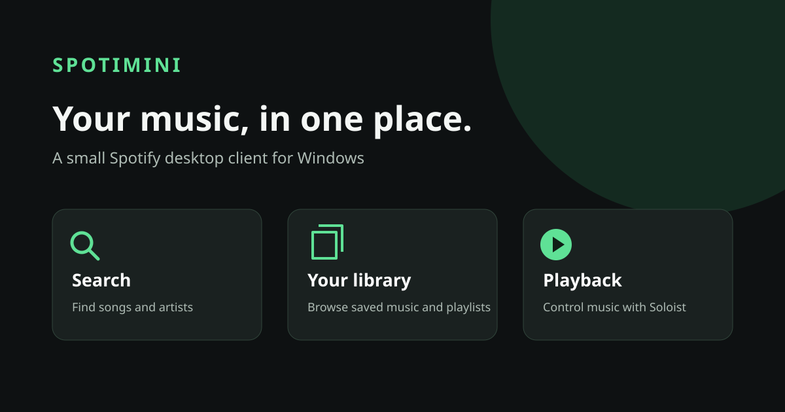
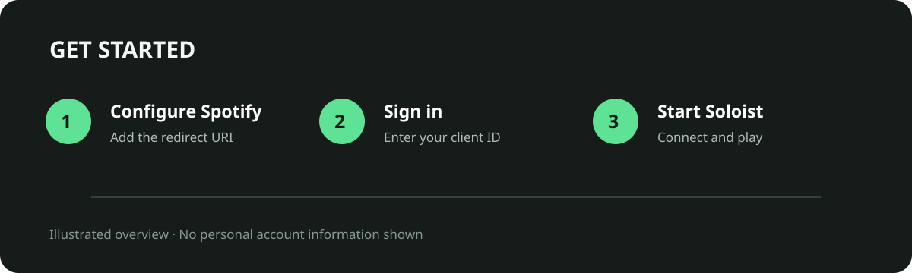

# Spotimini

Spotimini is a Windows desktop Spotify client written in Rust. It lets you sign in, search for tracks, browse your saved music and playlists, and control playback through Spotify Soloist.



## Requirements

- Windows and a Spotify Premium account.
- A Spotify Developer application with access for your account.
- A Spotify Soloist API key for local playback. See the [Soloist getting started guide](https://developer.spotify.com/documentation/soloist/tutorials/getting-started).
- Rust and Cargo if building from source.

## Build and run



```powershell
cargo build --release
.\target\release\spotimini.exe
```

In the Spotify Developer Dashboard, add `http://127.0.0.1:8888/callback` as a redirect URI. Open Spotimini, enter your application's client ID in Settings, and sign in with Spotify.

For playback, enter your Soloist API key in Settings and start the player. You can provide a path to `soloist.exe`, or leave it blank to let the app download Soloist. Select **Spotimini Soloist** in the Spotify device list on your phone, then choose a track in Spotimini.

Closing Spotimini also stops the Soloist process it started.

## Command line

```powershell
$env:SPOTIMINI_CLIENT_ID = "your-client-id"
cargo run -- login
cargo run -- search "search terms"
cargo run -- logout
```

The app uses OAuth with PKCE; a Spotify password or client secret is not required. The client ID, refresh token, and Soloist settings are stored locally in Windows Credential Manager. Never commit your own credentials or API keys to the repository.

Spotimini is an independent project and is not affiliated with Spotify.
